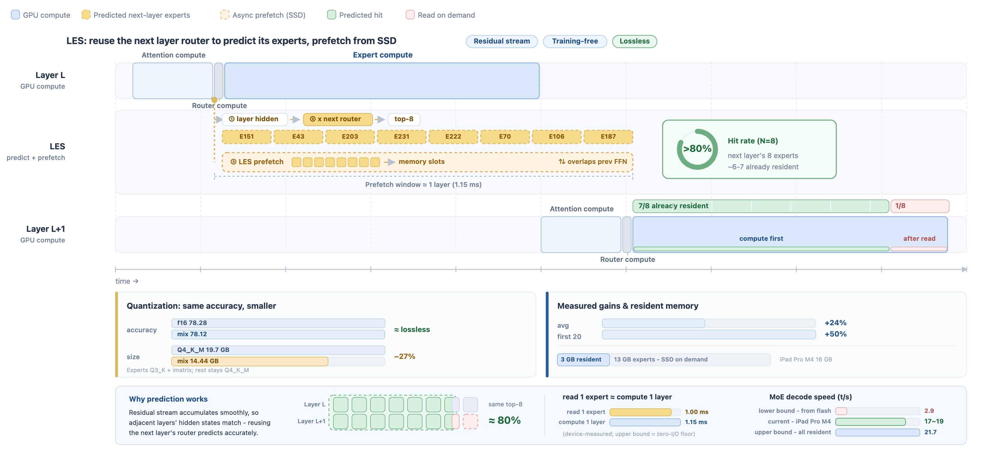

# LES: Lookahead Expert Scheduling

English | [Chinese](lookahead-expert-scheduling.zh.md)

LES runs the routed MoE experts of **MiniCPM-V 4.7 35B-A3B** from flash instead of RAM, and hides
the disk reads behind GPU work that is already running. Reading one expert (~1.00 ms) costs about as
much as computing a whole layer (~1.15 ms), so serving reads on demand lets disk latency set the pace
while the GPU sits idle.

Four changes break that serial dependency. The figure at the end shows the result.

## Highlights

- **Lookahead expert.** Layer L's hidden state is close to the one layer L+1 will route on, so
  multiplying it by layer L+1's router weight predicts that layer's top-k one layer early. The
  predicted experts are fetched from SSD while layer L computes, overlapping layer L+1's attention
  rather than blocking it, and ~81% are already resident when their layer runs. No training needed,
  and lossless: the router's real top-k still decides what runs.

- **Scheduling optimization.** The engine is reorganized around the lookahead idea so that disk reads
  stop sitting on the critical path. Expert weights are laid out for fewer, larger reads; fetched
  data goes straight into GPU-visible memory without an intermediate copy; the page cache is bypassed
  so it does not duplicate what the expert window already holds; the resident expert window is
  widened and shaped per layer; and frequently used experts are prewarmed before prefill so the first
  token is not pure disk time.

- **Fine-grained quantization.** Rather than quantizing the model uniformly, a parameter search
  allocates precision across tensor groups: the parts that dominate the bytes read are compressed
  harder, while accuracy-critical parts keep their precision.

- **DSpark.** A speculative decoding stage that composes with LES on the decode path.

