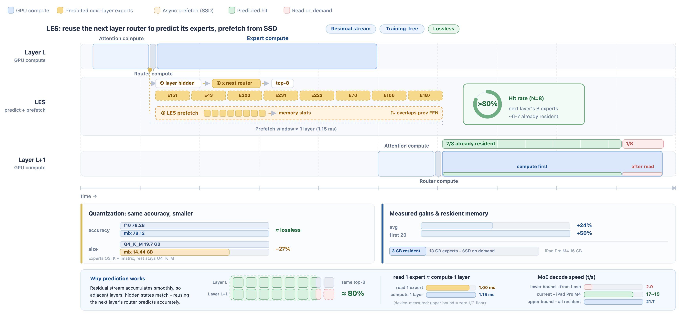

# LES: Lookahead Expert Scheduling

English | [Chinese](lookahead-expert-scheduling.zh.md)

Running MoE on-device is only the starting point. The real challenge is **keeping the model's capability while generating at a usable speed**. Keeping expert weights in storage such as SSD lifts the memory limit, but if loading and computation do not overlap effectively, the repeated waits for loading slow generation down. Approaches that cap the number of experts or fix the expert set can be faster, but risk degrading model capability.

MiniCPM-V 4.7 35B-A3B addresses this with **LES (Lookahead Expert Scheduling)**, which co-optimizes expert loading, compute scheduling and weight access, and combines it with an **adapted DSpark speculative sampling** stage, reaching **lossless inference at 20.51 token/s on iPhone 18 Pro Max (12 GB)** and **17.39 token/s on iPad Pro 11-inch M4 (16 GB)**.

## Core optimizations in LES

- **Expert prefetch and compute scheduling.** Cross-layer routing prediction loads the experts the next layer is likely to need ahead of time. Experts that the actual router selected and that are already loaded are computed first, while the remaining required experts are loaded in parallel, cutting load waits. Prediction is used only for prefetch and scheduling; computation still follows the model's own token-level routing, and any required expert missed by the prediction is loaded and used as usual. No additional training is needed.

- **Weight access optimization.** Expert loading is optimized along two axes, quantization and storage layout. Precise layer-wise mixed-precision quantization reduces weight storage and transfer cost while preserving model capability. Repacking the expert weights into contiguous storage reduces scattered reads and improves sequential read efficiency on flash. Together they lower what expert loading demands of on-device storage and bandwidth.

Optional, not part of the optimizations above: a model may ship a small trained predictor that replaces
the cross-layer routing guess for prefetch. It changes only what is prefetched, never the output, and
a model without one runs the same way. See `les-gguf-format.md`.

## Adapted DSpark speculative sampling

Speculative sampling is integrated into the on-device inference pipeline, working alongside LES expert scheduling and weight access optimizations to further improve decode efficiency.

## Results

### iPhone 18 Pro Max (12 GB)

Measured on **iPhone 18 Pro Max (12 GB)**. Decode speed is generated tokens divided by total decode time. The baseline is SSD expert loading with none of the optimizations below enabled.

| Optimization stage | Decode speed | vs previous | vs baseline |
| --- | ---: | ---: | ---: |
| Baseline: expert weights loaded from SSD, no optimizations below | 3.38 token/s | - | 1.00x |
| LES: lookahead expert scheduling | 6.57 token/s | 1.94x | 1.94x |
| LES: plus scheduling and load optimization, including weight layout, fewer read calls, and direct writes into GPU-visible memory | 11.34 token/s | 1.73x | 3.36x |
| LES: plus precise layer-wise mixed-precision quantization | 17.16 token/s | 1.51x | 5.08x |
| Full LES + DSpark speculative sampling | **20.51 token/s** | **1.19x** | **6.07x** |

### iPad Pro 11-inch M4 (16 GB)

Measured on **iPad Pro 11-inch M4 (16 GB)**. Test data covers MMMU, MathVista, CharXiv_reasoning_val, OCRBench, HumanEval, MBPP, AIME2025, AIME2026, Math500, and an internal text-dialogue Arena evaluation set.

The table shows measured results as each optimization is added. Decode speed is generated tokens divided by total decode time. The baseline is SSD expert loading with none of the optimizations below enabled. Both the gain over the previous stage and the gain over the baseline are listed.

| Optimization stage | Decode speed | vs previous | vs baseline |
| --- | ---: | ---: | ---: |
| Baseline: expert weights loaded from SSD, no optimizations below | 2.97 token/s | - | 1.00x |
| LES: lookahead expert scheduling and load optimization, including weight layout, fewer read calls, and direct writes into GPU-visible memory | 9.81 token/s | 3.30x | 3.30x |
| LES: plus precise layer-wise mixed-precision quantization | 14.92 token/s | 1.52x | 5.02x |
| Full LES + DSpark speculative sampling | **17.39 token/s** | **1.17x** | **5.86x** |

