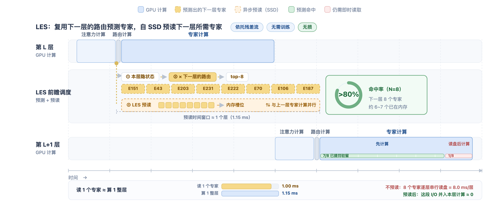

# LES：前瞻专家调度

[English](lookahead-expert-scheduling.md) | 中文

让 MoE 在端侧运行只是起点，真正的挑战是**同时保留模型能力与流畅的生成速度**。将专家权重存放在 SSD 等存储中可以突破内存容量限制，但若加载与计算无法有效并行，频繁的加载等待就会拖慢生成；限制专家数量、固定专家集合等方式虽能提速，却可能以模型能力退化为代价。

MiniCPM-V 4.7 35B-A3B 通过 **LES 前瞻专家调度**，协同优化专家加载、计算调度与权重存取，再结合 **DSpark 投机采样适配**，在 **iPad Pro 11 英寸 M4（16 GB）上实现无损推理与 17.39 token/s 的解码速度**。

## LES 的核心优化

- **前瞻专家调度。** 通过跨层路由预测，提前加载下一层可能用到的专家。优先计算实际路由选中且已加载的专家，同时并行加载其余所需专家，减少加载等待。预测仅用于预取与调度，实际计算仍遵循模型原有的 token 级路由；预测未命中的所需专家也会正常加载并参与计算，无需额外训练。

- **权重存取优化。** 从权重量化与存储布局两个方面优化专家加载：通过精细的逐层混合精度量化（layer-wise quantization），在保留模型能力的前提下减少权重存储与传输开销；通过重组专家权重布局实现连续存储，减少分散读取，提高闪存顺序读取效率。二者协同降低专家加载对端侧存储与带宽的需求。

## DSpark 投机采样适配

将投机采样融入端侧推理流程，与 LES 的专家调度和权重存取优化协同，进一步提高解码效率。

## 加速效果

测试设备为 **iPad Pro 11 英寸 M4（16 GB）**，测试数据包括 MMMU、MathVista、CharXiv_reasoning_val、OCRBench、HumanEval、MBPP、AIME2025、AIME2026、Math500，以及内部文本对话 Arena 评测集。

下表展示逐步加入各项优化后的实测结果。解码速度按生成的 token 数除以解码总时长计算，基准为未启用这些优化的 SSD 专家加载方案。表中分别列出相对上一阶段和相对基准的速度倍数。

| 优化阶段 | 解码速度 | 相比上一阶段 | 相比基准 |
| --- | ---: | ---: | ---: |
| 基准方案：专家权重从 SSD 加载，未启用下述优化 | 2.97 token/s | — | 1.00× |
| LES：前瞻专家调度与加载优化，包含权重布局优化、减少读取次数及直接写入 GPU 可见内存等 | 9.81 token/s | 3.30× | 3.30× |
| LES：进一步加入精细的逐层混合精度量化 | 14.92 token/s | 1.52× | 5.02× |
| 完整 LES + DSpark 投机采样 | **17.39 token/s** | **1.17×** | **5.86×** |

